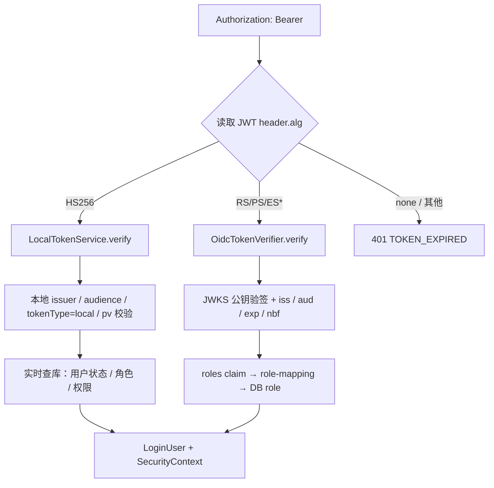
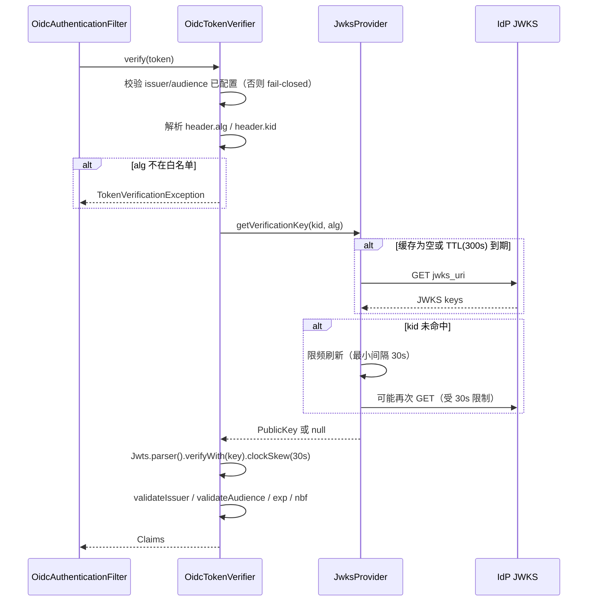
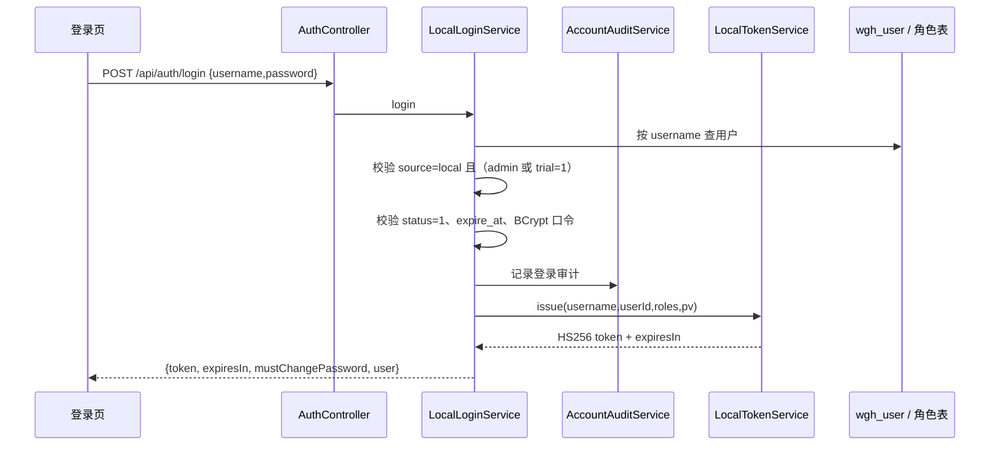
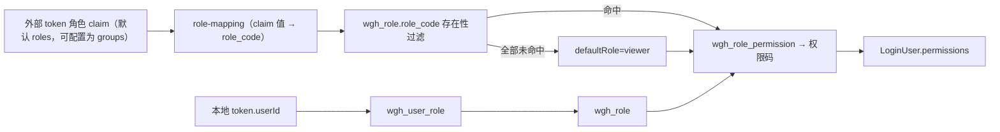
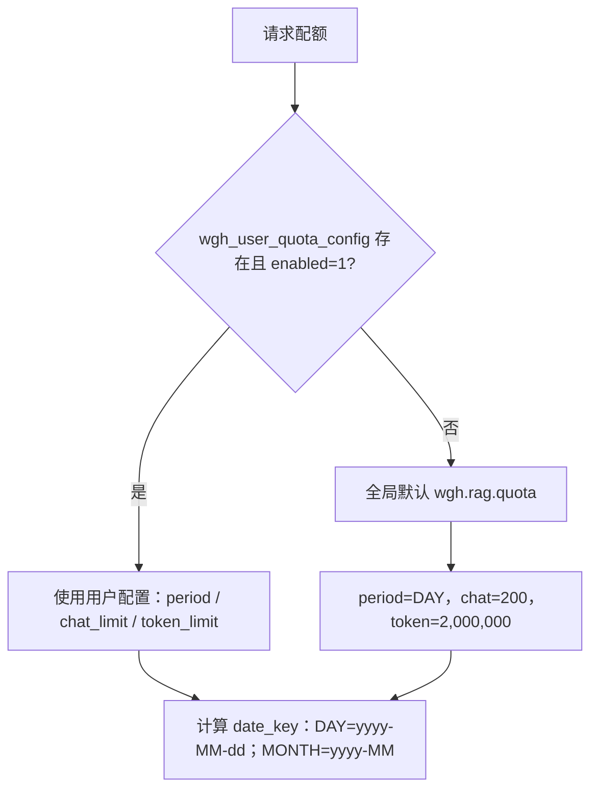
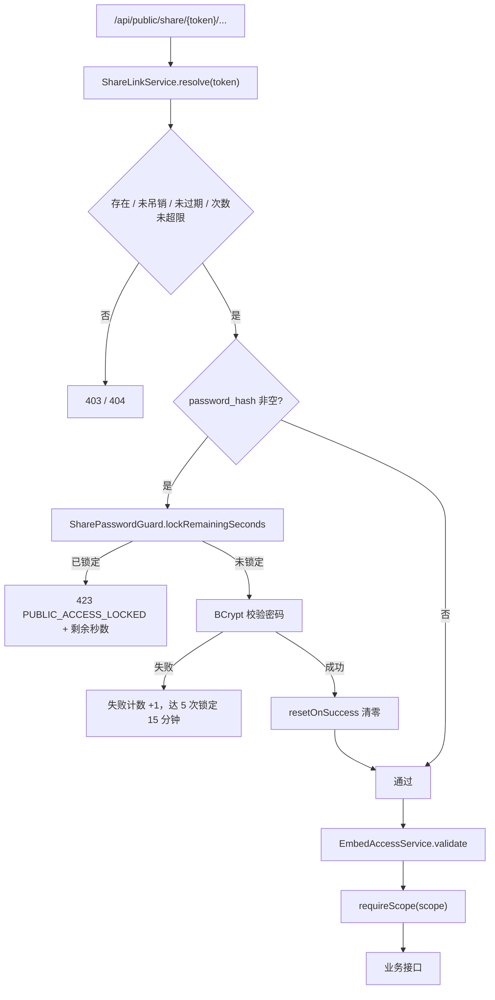
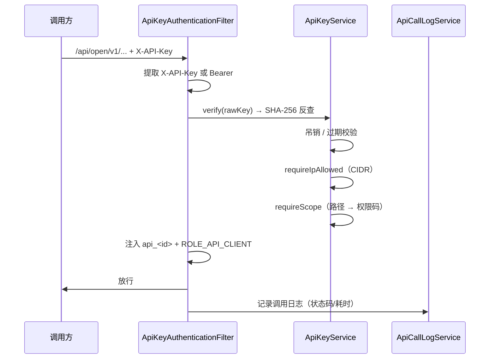
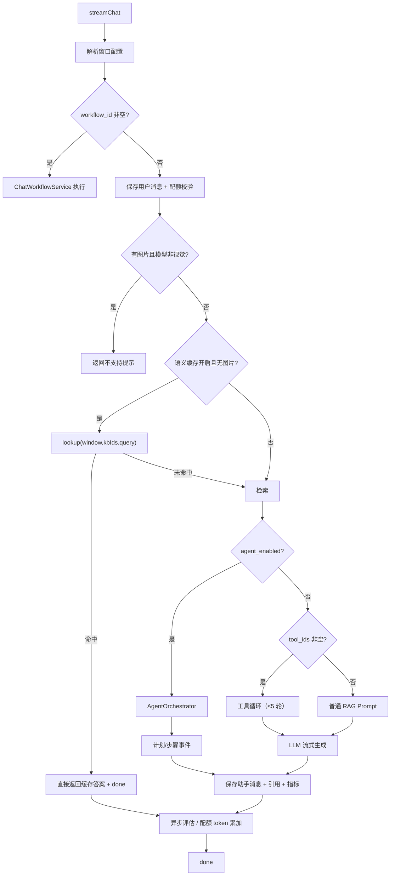
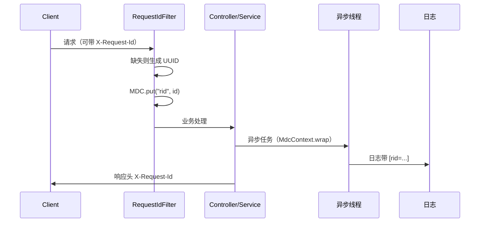

# WGH RAG System — 详细设计文档

| 项目 | 内容 |
| --- | --- |
| 文档版本 | v2.0 |
| 更新日期 | 2026-11-03 |
| 代码基线 | `main@212e90c` + 工作区当前代码（本次仅只读核对，未执行构建/测试） |
| 文档定位 | 实现级详细设计，面向开发、测试与代码评审 |
| 上层文档 | [design-overview.md](design-overview.md) |
| 接口清单 | [api.md](api.md) |

> 本文所有结论均来自当前源码与配置核对；与代码冲突时以代码为准。专项实现的更深说明见 `design-public-access.md`、`quota-design.md`、`design-file-storage.md`、`design-observability.md`、`agent-design.md`、`workflow-design.md`、`multi-agent-detail-design.md`。

---

## 1. 模块详细设计

### 1.1 模块与关键类

| 模块 | 关键类 | 职责与实现要点 | 显式依赖 |
| --- | --- | --- | --- |
| `rag-common` | `Result`、`ResultCode`、`BusinessException`、`LoginUser`、`RequestIdFilter`、`MdcContext`、`RagMetrics`、`LogSanitizer`、`WebMvcConfig` | 统一响应/错误码、登录用户 ThreadLocal、请求 ID 与 MDC、指标入口、日志脱敏、Jackson/Web 公共配置；**不含 MyBatis、Mapper、实体** | 无业务模块 |
| `rag-data` | `BaseEntity`、`MetaObjectHandlerImpl`、`MybatisPlusConfig`、`BooleanToSmallintTypeHandler` | 审计字段自动填充、PostgreSQL 分页插件、逻辑删除、布尔 ↔ SMALLINT 映射 | `rag-common` |
| `rag-log` | `@Audit`、`AuditAspect`、`AuditLogService`、`AuditLogMapper` | 切面采集操作人/IP/耗时/结果，异步落 `wgh_audit_log`；失败不阻断业务 | `rag-common`、`rag-data` |
| `rag-auth` | `SecurityConfig`、`OidcAuthenticationFilter`、`OidcTokenVerifier`、`JwksProvider`、`LocalTokenService`、`LocalLoginService`、`LocalPasswordService`、`AccountAuditService`、`PermissionAspect`、`InitialAdminAccountInitializer` | 双认证、RBAC、口令生命周期、安全过滤链 | `rag-common`、`rag-data`、`rag-log` |
| `rag-quota` | `QuotaService`、`EffectiveQuota`、`QuotaUsageMapper`、`UserQuotaConfigMapper`、`QuotaAdminGuard` | 配额解析（用户配置 > 全局）、按日/月原子累加、超限抛 429 | `rag-common`、`rag-data` |
| `rag-config` | `RagProperties`、`PgVectorConfig`、`PgVectorProperties`、`RedisCommandPort` | 检索/分割/上下文/缓存参数、pgvector 存储 Bean、Redis 命令端口 | `rag-common` |
| `rag-storage` | `FileStorageService`、`StoredObject`、`StorageKeys`、`StorageProperties`、`StorageConstants`、`LocalFileStorageService`、`AliyunOssFileStorageService` | 本地/OSS 双实现、逻辑 key、历史路径兼容、原子写/重试 | `rag-common` |
| `rag-llm` | `ChatModelFactoryRegistry`、`ModelCacheManager`、`ModelRouter`、`ModelPriceService`、`TokenEstimator`、各 Provider Factory | 模型工厂（OPENAI / DASHSCOPE / DEEPSEEK / CUSTOM_OPENAI / QWEN）、模型缓存、路由组切链、价格与 token 估算 | `rag-data`、`rag-config` |
| `rag-kb` | `KnowledgeBaseService`、`KnowledgeFileService`、`FileVersionService`、`RagRetrieveService`、`TextSplitter` + 切分策略、`SemanticCacheService`、`RerankService`、`QueryTransformService`、`DocumentParserDispatcher` | 知识库/文件 CRUD、异步向量化、混合检索、重排、查询变换、语义缓存、离线召回率脚本支持 | `rag-data`、`rag-storage`、`rag-llm` |
| `rag-chat` | `RagChatService`、`ContextCompressionService`、`ChatWindowService`、`ChatImageService`、`PromptTemplateService`、`ChatWorkflowService`、评估组件、`SkillLlmClientImpl` | 对话主编排、上下文压缩、窗口配置、会话复用/消息落库、提示词模板、工作流绑定、评估、图片处理 | `rag-data`、`rag-kb`、`rag-tool`、`rag-agent`、`rag-workflow`、`rag-quota` |
| `rag-tool` | `ToolExecutionEngine`、`HttpToolExecutor`、`McpToolExecutor`、`McpClientManager`、`FunctionCallingToolExecutor`、`SkillToolExecutor`、`SkillLlmClient` | 工具定义/执行/超时/截断、窗口级 ThreadLocal 注册、MCP transport、Skill 目录/内联加载 | `rag-data`、`rag-config` |
| `rag-agent` | `AgentOrchestrator`、`Planner`、`StepExecutor`、`StepScheduler`、`ReflectionEngine`、`PlanLifecycleService`、`HitlGate`、`AgentEventPublisher` | 计划生成、调度、执行、反思、HITL、状态机与 SSE | `rag-config`、`rag-common`、`rag-llm`、`rag-kb`、`rag-tool` |
| `rag-workflow` | `WorkflowEngine`、`WorkflowService`、`GraphValidator`、`NodeExecutorRegistry`、各 NodeExecutor、`WorkflowTriggerService`、`WorkflowTemplateRegistry` | DAG 校验与并行调度、11 类节点、版本/触发器/运行记录、模板市场 | `rag-config`、`rag-common`、`rag-data`、`rag-llm`、`rag-kb`、`rag-tool`、`rag-agent` |
| `rag-agent-multi` | `MultiAgentService`、`MultiAgentRuntime`、`CrewCoordinator`、`GraphCoordinator`、`GroupChatCoordinator`、`GroupChatManager`、`MessageBus`、`AgentInstanceExecutor` | 6 种协作模式、运行/步骤/团队落库、SSE | `rag-agent`、`rag-workflow`、`rag-tool`、`rag-kb`、`rag-llm`、`rag-chat`、`rag-config`、`rag-common` |
| `rag-public-access` | `ShareLinkService`、`ApiKeyService`、`ApiCallLogService`、`EmbedAccessService`、`SharePasswordGuard`、`PublicAccessRateLimiter`、`DefaultPublicAccessStore`、`ClientIpResolver`、`DomainWhitelistMatcher`、`ApiKeyAuthenticationFilter` | 分享/Widget/开放 API、密码锁定、Lua 限流、IP/CIDR 白名单 | `rag-common`、`rag-data`、`rag-auth`、`rag-config`、`rag-chat`、`rag-kb` |
| `rag-controller` | 21 个 Controller、`GlobalExceptionHandler`、SSE 适配器 | 参数校验、身份透传、SSE 事件封装、统一异常 | 全部业务模块 + `rag-data/config/auth/log/quota` |
| `rag-app` | `RagApplication`、`application*.yml`、`logback-spring.xml` | 启动、配置装配、审计/指标/安全自动配置 | `rag-data`、`rag-auth`、`rag-log`、`rag-controller` |

### 1.2 依赖设计要点

- **核心 RAG 链**：`rag-chat → rag-kb → rag-llm`，`rag-kb → rag-storage`；上层不得被下层反向依赖。
- **JDK 统一**：根 POM Enforcer 执行 `requireJavaVersion [21,22)`，CI 与本地构建固定 JDK 21。
- **`rag-public-access` 只被 `rag-controller` 直接依赖**：根 POM 执行 `enforce-public-access-not-consumed`（`rag-controller` 跳过该执行），`rag-public-access` 自身再禁止依赖 `rag-controller`；`searchTransitive=false` 避免传递依赖误伤。
- **`rag-common` 零 ORM**：仅依赖 Web/Security/AOP/Micrometer 等基础库与 `spring-tx`（映射 `DuplicateKeyException`），不引入 MyBatis-Plus。
- **唯一组合根**：只有 `rag-controller` 同时依赖全部业务模块；`rag-app` 只依赖 `rag-controller`、`rag-data`、`rag-auth`、`rag-log`。

---

## 2. 认证与授权详细设计

### 2.1 凭证分流



过滤器 `OidcAuthenticationFilter` 的白名单（前缀匹配）：

- `/api/auth/login`、`/api/auth/logout`
- `/api/workflows/webhook/`（路径 token 鉴权）
- `/doc.html`、`/webjars/`、`/v3/api-docs`、`/swagger-resources`、`/favicon.ico`、`/actuator`

其他路径必须携带 Bearer token；未携带直接返回 HTTP 401 + `1001`。

### 2.2 外部 OIDC 验签



实现细节：

| 项 | 行为 |
| --- | --- |
| 算法白名单 | `RS256/384/512`、`PS256/384/512`、`ES256/384/512`；拒绝 `HS*` 与 `none` |
| JWKS 解析 | 仅取 `use=sig` 或未声明 `use` 的 RSA / EC 公钥；EC 支持 P-256 / P-384 / P-521 |
| JWKS 端点 | 优先 `wgh.auth.oidc.jwks-uri`；为空时用 `issuer + /.well-known/openid-configuration` 发现 |
| 缓存 | `keyCache` 原子替换，读路径无锁；TTL 默认 300s |
| 刷新限频 | `lastAttemptNanos` + `jwksRefreshMinIntervalSeconds=30`；未知 kid 也受此限制 |
| 网络失败 | 捕获异常并沿用旧缓存；无旧缓存时返回 null，调用方 401 |
| 启动 | 不主动拉取，IdP 不可达不阻断启动 |
| fail-closed | `issuer` 或 `audience` 任一为空即拒绝所有外部 token |
| 时钟偏差 | 默认 30s |

### 2.3 本地登录与内部 token



内部 token claim：

| claim | 含义 |
| --- | --- |
| `iss` / `aud` | `wgh-local`（可配置），与外部 IdP 区分 |
| `sub` | 用户名 |
| `userId` | 用户主键 |
| `roles` | 登录时数据库角色快照（仅展示用，鉴权时重新查库） |
| `pv` | 口令版本，对应 `wgh_user.password_version` |
| `tokenType` | 固定 `local`，本地验签强制校验 |
| `iat` / `exp` | 默认 TTL 7200s |

本地 token 校验链：

1. header `alg` 必须为 `HS256`；
2. 本地密钥验签（生产未配置或长度 <32 字节直接启动失败；dev 可用随机密钥）；
3. `issuer`、`audience`、`tokenType=local` 校验；
4. `userId` 存在；
5. 用户存在、`status=1`、`expire_at` 未过期；
6. `pv` 与 `password_version` 一致，否则 `1007 SESSION_INVALID`；
7. 角色实时查 `wgh_user_role`，权限实时查 `wgh_role_permission`；
8. `password_must_change=1` 时拦截非只读请求（`GET/HEAD/OPTIONS` 与 `/api/auth/password`、`/api/auth/logout` 除外），返回 HTTP 403 + `1006`。

### 2.4 角色 → 权限链路



- 外部 token 未携带角色或映射后不在 DB：使用 `wgh.auth.oidc.default-role`（默认 `viewer`）。
- 本地 token 角色为空：使用 `LoginUser.DEFAULT_ROLE`（`viewer`）。
- token 中的权限声明一律忽略，权限只来自 `wgh_role_permission`。
- 权限注解：`@RequiresPermission("xxx")` 由 `PermissionAspect` 拦截；未注解接口仅要求登录。

### 2.5 密码生命周期

| 事件 | 行为 |
| --- | --- |
| 首次创建 admin | `InitialAdminAccountInitializer` 读取 `WGH_INIT_ADMIN_PASSWORD`；库中已有 `admin` 则跳过；写入 `source=local`、BCrypt、`password_must_change=1` |
| 登录 | 校验 source/trial/status/expire/BCrypt；失败写审计 |
| 本人改密 | 校验旧密码 + 强度 + 新旧不同；BCrypt 更新；`password_must_change=0`；`password_version++` |
| 管理员重置体验账号 | 仅允许 `trial=1` 且 `source=local`（空白按 local 兼容）；设置 `password_must_change=1`；`password_version++` |
| 禁用账号 | `status=0`；本地过滤器立即拒绝 |
| 审计 | `AccountAuditService` 记录操作人、目标、结果、原因；不记录口令 |
| 日志脱敏 | `LogSanitizer.maskSecret` 对 token/key/grant 做掩码；登录日志不含口令 |

密码强度默认值（`wgh.auth.password.*`）：

| 配置 | 默认 |
| --- | --- |
| `min-length` | 8 |
| `max-length` | 128 |
| `require-letter` | true |
| `require-digit` | true |

### 2.6 安全过滤链

| 链 | 顺序 | 匹配路径 | 说明 |
| --- | --- | --- | --- |
| 公开访问链 | `@Order(1)` | `/api/public/**`、`/api/open/**` | `permitAll` + `ApiKeyAuthenticationFilter`（仅 `/api/open/`）+ 公开访问业务校验；不放开其他路径 |
| 主应用链 | `@Order(2)` | 其余路径 | `permitAll` + `OidcAuthenticationFilter`；方法级 `@RequiresPermission` |
| ASYNC / ERROR | 主链 | `DispatcherType.ASYNC/ERROR` | 显式 `permitAll`，避免 SSE 异步分发时 SecurityContext 为空被误判为匿名 |

### 2.7 错误码（认证相关）

| 业务码 | HTTP | 场景 |
| --- | --- | --- |
| `1001 UNAUTHORIZED` | 401 | 未携带 token |
| `1002 TOKEN_EXPIRED` | 401 | 外部 token 验签失败/过期 |
| `1003 TOKEN_INVALID` | 401 | API Key 缺失/无效 |
| `1004 PERMISSION_DENIED` | 403 | 权限不足 |
| `1005 LOGIN_FAILED` | 200 | 登录失败（统一响应体） |
| `1006 PASSWORD_CHANGE_REQUIRED` | 403 | 首登未改密 |
| `1007 SESSION_INVALID` | 401 | `pv` 不一致/账号失效 |
| `3004 PUBLIC_ACCESS_LOCKED` | 403/423 | 分享密码锁定 |
| `429 QUOTA_EXCEEDED` | 429/200 | 配额或限流超限 |

---

## 3. 配额详细设计

### 3.1 配置优先级



- 用户配置字段：`username`、`enabled`、`period`（`DAY`/`MONTH`）、`chat_limit`、`token_limit`；
- 全局默认只提供“每日”上限，不支持全局 `MONTH`；
- `limit <= 0` 表示该维度不限制；
- 管理员接口受 `QuotaAdminGuard` 保护，禁止修改自身配额。

### 3.2 原子累加

```sql
INSERT INTO wgh_quota_usage (username, date_key, chat_count, token_used)
VALUES (?, ?, ?, ?)
ON CONFLICT (username, date_key)
DO UPDATE SET chat_count = wgh_quota_usage.chat_count + EXCLUDED.chat_count,
              token_used = wgh_quota_usage.token_used + EXCLUDED.token_used,
              update_time = now()
```

- `checkAndIncrementChat`：先查有效配额，超限直接抛 `QUOTA_EXCEEDED`；未超限原子 +1；
- `addTokens`：生成结束后累加输入/输出 token；异常只 WARN；
- `wgh_quota_usage` 唯一键 `(username, date_key)`；
- 指标：`wgh.quota.exceeded`（tag `type=chat/token`）。

---

## 4. 公开访问详细设计

### 4.1 数据模型

| 表 | 关键字段 | 说明 |
| --- | --- | --- |
| `wgh_share_link` | `token`、`scope`、`target_id`、`expires_at`、`password_hash`、`max_uses`、`use_count`、`revoked`、`embed_enabled`、`embed_origin_whitelist`、`embed_ip_whitelist` | `scope`：`WINDOW` / `SESSION` / `KB` |
| `wgh_api_key` | `key_prefix`、`key_hash`、`scopes`、`expires_at`、`revoked`、`ip_whitelist`、`last_used_time` | 仅存 SHA-256，明文只返回一次 |
| `wgh_api_call_log` | `api_key_id`、`path`、`status_code`、`duration_ms`、`client_ip` | 开放 API 调用审计 |

### 4.2 分享访问流程



- 分享 token 为随机不可猜测字符串；
- 密码校验通过后才允许访问业务接口；
- Widget 模式必须携带 `X-Embed-Grant`（或通过 `widget.js` 获取）；
- 非嵌入的普通分享页同源 XHR 不受域名白名单限制。

### 4.3 Widget 授权

| 项 | 行为 |
| --- | --- |
| 入口 | `POST /api/public/share/{token}/embed/authorize` |
| 来源校验 | `Origin` → 主机名；缺失时取 `Referer`；域名白名单 + IP/CIDR 白名单 |
| 拒绝策略 | 缺少 Origin/Referer 默认拒绝 |
| grant | `eg_<uuid>`，绑定 `token + clientIp`，Redis 存储，默认 30 分钟 |
| 后续调用 | 校验 `X-Embed-Grant` 与当前 IP 一致；过期/不一致拒绝 |
| 检测嵌入模式 | `X-Embed-Mode: 1`、`Sec-Fetch-Dest: iframe`、`?embed=1`、`X-Embed-Grant` |
| 未开启嵌入 | 任何嵌入模式请求直接拒绝 |
| 白名单为空 | 已开启嵌入但域名/IP 白名单均为空时，允许任意来源（配置语义明确） |

### 4.4 限流

| 项 | 实现 |
| --- | --- |
| 算法 | 60 秒滑动窗口 |
| 维度 | `share-token`、`share-ip`、`share-chat`、`share-kb`、`share-embed`、`api-key`、`api-ip` |
| Redis key | `wgh:pa:rl:{dimension}:{path}:{subject}`（非法字符替换为 `_`） |
| Lua | `ZREMRANGEBYSCORE` 清理过期 → `ZCARD` 判断 → `ZADD` 当前请求 → `PEXPIRE`；超限返回 `-1` |
| 上限优先级 | `rate-limit.overrides[dimension:path]` > `overrides[dimension]` > `share-rate-limit-per-minute`(20) / `api-rate-limit-per-minute`(60) > `default-per-minute`(60) |
| 降级 | Redis 不可用 → 进程内 `Deque` 滑动窗口；10s 内不再重试 Redis；多实例计数不一致（已知限制） |
| 超限响应 | HTTP 429 + `429 QUOTA_EXCEEDED`，data 含 `dimension`、`limitPerMinute`、`retryAfterSeconds`、`store` |

### 4.5 开放 API



路径 → scope：

| 路径片段 | 所需 scope |
| --- | --- |
| `/v1/chat/` | `chat:write` |
| `/v1/kb/` | `kb:read` |
| `/v1/usage` | `usage:read` |

IP 白名单支持单 IP 与 CIDR；为空表示不限制；可信代理头仅在 `trusted-proxies` 命中时采信。

---

## 5. 文件存储详细设计

### 5.1 契约

```java
public interface FileStorageService {
    StoredObject store(Long kbId, Long fileId, String fileName, InputStream in, long size);
    InputStream openStream(String key);
    void delete(String key);
    String resolveUrl(String key);
    boolean exists(String key);
}
```

`StoredObject`：`key`、`size`、`contentType`。

### 5.2 key 规则

```text
kb/{kbId}/{fileUuid}/{sanitize(fileName)}
```

- 每次上传生成新 UUID，不覆盖同名文件；
- `sanitize` 去除路径分隔符、`..`、控制字符，保留扩展名；
- OSS 可叠加 `wgh.rag.storage.oss.key-prefix`。

### 5.3 实现差异

| 能力 | 本地 | OSS |
| --- | --- | --- |
| 写入 | 临时文件 + `ATOMIC_MOVE` | 临时文件 + `putObject`，按 `max-retries` 重试，失败清理 |
| 读取 | 根目录校验后 `Files.newInputStream` | `getObject` 流 |
| 删除 | 文件不存在视为成功 | 失败 WARN；数据库仍逻辑删除 |
| URL | `url-prefix + key`（逻辑地址，非下载服务） | `public-read` 直链或签名 URL（默认 60 分钟） |
| 历史路径 | 识别 `./uploads/...` 并做根目录校验 | 不识别本地路径 |
| 大小限制 | `max-file-size-mb=50` | `max-file-size-mb=50` |

配置：`wgh.rag.storage.type=local|oss`；OSS 必填 `endpoint`、`bucket`、`access-key-id`、`access-key-secret`；缺失时启动 WARN，调用时报错。

---

## 6. RAG 对话详细设计

### 6.1 组件与职责

| 组件 | 职责 |
| --- | --- |
| `RagChatService` | 对话编排、分支决策、SSE、会话复用、消息落库、指标 |
| `ChatWindowService` | 窗口 CRUD、工具/工作流/Agent/评估配置 |
| `ChatImageService` | 多模态图片获取、校验与降采样 |
| `ContextCompressionService` | 分层压缩、持久化、复用、降级 |
| `RagRetrieveService` | 多知识库检索、RRF、重排、查询变换、指标 |
| `SemanticCacheService` | 问题向量缓存、命中/保存/失效/清理 |
| `PromptTemplateService` | 模板 CRUD、版本、`{{var}}` 渲染、前缀联想接口 |
| `ChatWorkflowService` | 窗口绑定工作流、运行与事件桥接 |
| `EvaluationScheme` / `LlmJudgeService` | 检索指标 / 生成侧 judge |
| `SkillLlmClientImpl` | 为 `rag-tool` 的 Skill 提供模型调用 |

### 6.2 主流程



### 6.3 语义缓存

| 项 | 值 / 行为 |
| --- | --- |
| 范围 | 窗口 + 知识库集合 + 问题向量 |
| 阈值 | 默认 0.95 余弦相似度 |
| 上限 | 每窗口 500 条 |
| TTL | 默认 1440 分钟 |
| 跳过条件 | 无启用窗口、有图片、知识库为空 |
| 写入 | 生成完成后保存答案与向量；失败 WARN 不影响主流程 |
| 失效 | 窗口删除、知识库重切/删除时清理 |

### 6.4 检索

`RagRetrieveService.searchMultiple(kbIds, query, RetrievalOptions)`：

1. 按 embedding 模型 ID 分组知识库；
2. 每组执行向量检索；
3. `hybridEnabled` 时增加关键词检索并用 RRF 融合；
4. `rerankModelId` 非空时对候选重排；
5. `queryTransformMode` 非 `NONE` 且有 `transformModelId` 时先做 REWRITE / MULTI_QUERY / HYDE；
6. 过滤 `minScore`（默认 0.3）、截断 `topK`（默认 5）；
7. 返回 `RetrieveResult`：matches、多知识库命中、耗时、`coverageRate`、`hitRate`。

### 6.5 上下文压缩

| 项 | 值 / 行为 |
| --- | --- |
| 触发 | 历史消息 > 20 条 |
| 近期 | 最近 4 轮保留原文 |
| 中期 | 6 轮生成 3–5 句摘要 |
| 远期 | 抽取结构化事实（≤400 token） |
| 摘要上限 | 600 token |
| 超时 | 20s |
| 持久化 | `wgh_chat_session` 的 `mid_summary*` / `long_term_facts*` 字段保存摘要、覆盖轮次、模型、prompt 版本、时间 |
| 复用 | 范围 + prompt 版本匹配时直接复用 |
| 降级 | 无模型、API 异常/超时、测试环境依赖缺失 → 简单截断 |

### 6.6 工具调用循环

- 工具按窗口 `tool_ids` 注册到 ThreadLocal 快照；
- 每轮把工具定义以 OpenAI Function JSON Schema 传给模型；
- 模型返回 tool_calls → `ToolExecutionEngine` 执行 → 结果回填；
- 结果 > 4000 字符截断；
- 最多 5 轮；
- 每轮发送 `tool_call_start` / `tool_call_result`；
- 工具异常结构化返回，不终止对话（除非配置要求）。

### 6.7 评估

| scheme | 行为 |
| --- | --- |
| `NONE` | 不评估 |
| `METRICS` | 纯后端计算 MRR / NDCG / Precision@k / Recall@k（需标注集） |
| `LLM_JUDGE` | 异步生成侧评估 |
| `BOTH` | 同时启用 |

LLM-as-judge：

- judge 模型优先使用用户指定；未指定时选择 2 个不同提供商模型，排除当前聊天模型；
- 多 judge 重复评估，报告中位数与一致性；
- 指标：Faithfulness、Answer Relevancy（当前代码仅实现这两项生成侧指标），并输出 `judgeAgreement` 一致性与 `judgeCount`；
- 异步执行，通过 `judge` 事件回传，不阻塞 `done`。

### 6.8 SSE 协议

| 事件 | data 关键字段 |
| --- | --- |
| `start` | `messageId`、`sessionId`、`model` |
| `retrieve` | `results`、`totalMatches`、`filteredMatches`、`coverageRate`、`hitRate` |
| `content` | JSON 字符串 `{"text":"..."}`，避免换行丢失 |
| `sources` | 去重后的文档引用（同文档保留最高分） |
| `accuracy` | 在线正确率/覆盖率 |
| `metrics` | 检索耗时、首 token、总耗时、token、成本 |
| `model_switch` | `from`、`to`、`reason` |
| `tool_call_start` | `toolName`、`arguments`、`round` |
| `tool_call_result` | `toolName`、`result`、`truncated`、`durationMs` |
| `judge` | `faithfulness`、`answerRelevancy`、`judgeAgreement`、`judgeCount` |
| `done` | `messageId`、`usage` |
| `error` | `code`、`message` |

历史消息回显与流式渲染必须共用同一前端口径：Markdown、引用去重、指标展示规则一致。

### 6.9 模型路由与故障转移

```text
resolveChain(routeGroup, llmModelId):
  1. routeGroup 非空 → 查 status=1、model_type=CHAT、route_group 的模型，按 route_priority, id 升序
  2. 链路为空 → 回退 llmModelId 单模型
  3. 仍为空 → BusinessException
```

- `route_group` 用于普通 RAG 的优先级切链；
- Agent / Workflow 只使用 `primaryModelId`（链首），不做跨模型切链；
- 流式 `onError` 在回调线程直接发送 `error`，不会回到 `runWithFailover`，因此首 token 前失败也不进切链（已知限制）。

---

## 7. Agent / 工作流 / 多 Agent

### 7.1 单 Agent

| 组件 | 职责 |
| --- | --- |
| `Planner` | 生成计划：步骤、依赖、工具、知识库、`hitl` 标记 |
| `StepScheduler` | 按依赖拓扑调度可执行步骤 |
| `StepExecutor` | 执行单步，内部 ReAct 工具循环 ≤5 轮 |
| `ReflectionEngine` | Critic 打分，低于阈值重试 |
| `HitlGate` | 暂停/恢复、人工确认 |
| `PlanLifecycleService` | 计划状态迁移与持久化 |
| `AgentEventPublisher` | 发送 Agent SSE |

状态：`PENDING / RUNNING / PAUSED / COMPLETED / FAILED / CANCELLED / SKIPPED / SUCCESS / HITL_PENDING`。

Agent SSE 事件：`plan_created`、`plan_create_failed`、`step_start`、`step_success`、`step_failed`、`step_retry`、`step_reflection`、`step_skipped`、`step_hitl_pending`、`plan_paused`、`plan_resumed`、`plan_updated`、`plan_cancelled`、`plan_complete`、`plan_failed`。

关键约束：

- 结果先落库再发送 SSE；
- SSE 发送失败只 WARN，不降级普通 RAG；
- HITL 与反思开关解耦（`agent_hitl_enabled` 独立）；
- 前端收到 `step_hitl_pending` 时动态补建步骤条目；
- 刷新后按 `RUNNING` 计划 2 秒轮询恢复。

### 7.2 工作流

| 项 | 内容 |
| --- | --- |
| 节点类型 | `START`、`END`、`LLM`、`RETRIEVAL`、`TOOL`、`CONDITION`、`LOOP`、`HITL`、`VARIABLE`、`WORKFLOW`、`AGENT` |
| 图校验 | 单 START、可达 END、无环（LOOP 回边白名单）、节点配置合法 |
| 调度 | 入边完成计数 + 并行执行；`PauseSignal` 暂停 |
| 状态 | 运行：`PENDING/RUNNING/PAUSED/COMPLETED/FAILED/CANCELLED`；节点：`PENDING/RUNNING/SUCCESS/FAILED/HITL_PENDING/CANCELLED` |
| 版本 | 保存生成版本快照；回滚生成新版本 |
| 触发器 | CRON、WEBHOOK（路径 token）；Webhook 免登录 |
| 模板 | 内置模板注册；实例化自动填充首个启用 LLM 模型 |
| 分享运行 | JWT + shareToken；`safeMode=true`：HTTP 仅 GET/HEAD、禁 MCP；归属校验 |
| SSE | `workflow_start`、`node_start`、`node_output`、`node_error`、`node_hitl_pending`、`workflow_complete`、`workflow_failed`、`workflow_cancelled` |

### 7.3 多 Agent

运行模式（`wgh_m_agent_run.mode`）：

| 模式 | 协调器 | 说明 |
| --- | --- | --- |
| `CREW_SEQUENTIAL` | `CrewCoordinator` | 角色顺序执行 |
| `CREW_HIERARCHICAL` | `CrewCoordinator` | 经理 Agent 分派 |
| `CREW_PARALLEL` | `CrewCoordinator` | 角色并行 |
| `GRAPH_ROUTED` | `GraphCoordinator` | DAG 路由 |
| `GROUP_CHAT_ROUND_ROBIN` | `GroupChatCoordinator` | 轮流发言 |
| `GROUP_CHAT_DYNAMIC_ROUTER` | `GroupChatCoordinator` + `GroupChatManager` | 动态选择发言者 |

SSE：`multi_agent_start`、`agent_start`、`agent_rag`、`agent_tool_call_start`、`agent_tool_call_result`、`agent_reflection`、`agent_done`、`agent_turn_start`、`agent_turn_end`、`agent_message`、`agent_hitl_pending`、`multi_agent_resume`、`multi_agent_complete`、`multi_agent_error`。

---

## 8. 数据层详细设计

### 8.1 公共基类与类型处理

`BaseEntity`：

| 字段 | 说明 |
| --- | --- |
| `id` | 雪花/自增主键（按表定义） |
| `create_time` / `update_time` | `MetaObjectHandlerImpl` 自动填充 |
| `create_by` / `update_by` | 登录用户自动填充 |
| `deleted` | 逻辑删除（0/1） |

布尔约定：

- PostgreSQL 列类型 `SMALLINT`；
- 实体 `Boolean` 字段必须标注 `@TableField(typeHandler = BooleanToSmallintTypeHandler.class)`；
- `LambdaQueryWrapper` 的 `eq` 必须用字面量 `1/0`，不得传 `true/false`；
- 变更列类型时先 `DROP DEFAULT`，再 `ALTER TYPE`，最后 `SET DEFAULT`。

### 8.2 表分组（37 张）

| 域 | 表 |
| --- | --- |
| 模型与价格 | `wgh_llm_model`、`wgh_embedding_model`、`wgh_model_price` |
| 知识库 | `wgh_knowledge_base`、`wgh_knowledge_file`、`wgh_knowledge_file_version`、`wgh_kb_ground_truth`、`wgh_semantic_cache` |
| 标签 | `wgh_tag`、`wgh_kb_tag_rel`、`wgh_file_tag_rel` |
| 聊天 | `wgh_chat_window`、`wgh_chat_session`、`wgh_chat_message` |
| 工具/提示词 | `wgh_tool`、`wgh_prompt_template` |
| 单 Agent | `wgh_agent_plan`、`wgh_agent_step` |
| 工作流 | `wgh_workflow`、`wgh_workflow_version`、`wgh_workflow_trigger`、`wgh_workflow_run`、`wgh_workflow_node_run` |
| 多 Agent | `wgh_m_agent_run`、`wgh_m_agent_step`、`wgh_m_agent_crew` |
| 账号/RBAC | `wgh_user`、`wgh_role`、`wgh_permission`、`wgh_user_role`、`wgh_role_permission` |
| 审计 | `wgh_audit_log` |
| 配额 | `wgh_quota_usage`、`wgh_user_quota_config` |
| 公开访问 | `wgh_share_link`、`wgh_api_key`、`wgh_api_call_log` |

### 8.3 关键表字段

| 表 | 关键字段 |
| --- | --- |
| `wgh_user` | `username`、`source`（`local`/`oidc`）、`password_hash`、`password_version`、`password_must_change`、`trial`、`status`、`expire_at` |
| `wgh_role` / `wgh_permission` | `role_code`、`role_name`；`perm_code`、`perm_name` |
| `wgh_role_permission` | `role_code`、`perm_code` |
| `wgh_chat_window` | `llm_model_id`、`knowledge_base_ids`、`tool_ids`、`workflow_id`、`semantic_cache_enabled`、`rerank_enabled`、`rerank_model_id`、`hybrid_enabled`、`query_transform_mode`、`rewrite_model_id`、`evaluation_scheme`、`judge_model_ids`、`agent_enabled`、`agent_max_steps`、`agent_planner_model_id`、`agent_executor_model_id`、`agent_critic_model_ids`、`agent_reflection_threshold`、`agent_hitl_enabled` |
| `wgh_share_link` | `token`、`scope`、`target_id`、`password_hash`、`max_uses`、`use_count`、`revoked`、`embed_enabled`、`embed_origin_whitelist`、`embed_ip_whitelist` |
| `wgh_api_key` | `key_prefix`、`key_hash`、`scopes`、`ip_whitelist`、`revoked`、`expires_at`、`last_used_time` |
| `wgh_agent_plan` | `session_id`、`chat_window_id`、`llm_model_id`、`status`、`user_goal`、`plan_json`、`current_step_index`、`max_steps`、`total_tokens` |
| `wgh_agent_step` | `plan_id`、`step_index`、`step_id`、`status`、`depends_on`、`action_tool`、`action_input`、`observation`、`reflection_score`、`retry_count`、`max_retries`、`result_summary`、`token_count` |
| `wgh_workflow_run` | `workflow_id`、`session_id`、`workflow_version`、`input_text`、`status`、`output_text`、`context_json`、`graph_snapshot`、`error_message`、`executed_nodes`、`total_nodes`、`duration_ms` |
| `wgh_workflow_node_run` | `run_id`、`node_id`、`node_type`、`node_name`、`status`、`iteration`、`input_json`、`output_json`、`error_message`、`duration_ms` |

### 8.4 向量存储

- `PgVectorConfig` 构建 `PgVectorEmbeddingStore`，表名默认 `rag_vector_store`，维度来自当前 embedding 模型；
- 复用 Spring HikariCP 数据源；
- pgvector 不可用时由 `PgVectorProperties.allowFallbackToInMemory` 决定是否降级 `InMemoryEmbeddingStore`，生产默认关闭；
- 不同 embedding 模型维度不可混用，检索按模型 ID 分组；
- 文件重切/删除必须同步删除对应 `file_id` 的旧向量，避免重复与幽灵引用；
- 语义缓存向量表 `wgh_semantic_cache_vec` 独立于知识库向量。

### 8.5 SQL 组织

- `schema.sql`：全部 DDL、索引、COMMENT，使用 `CREATE TABLE IF NOT EXISTS`、`CREATE INDEX IF NOT EXISTS`；
- `data.sql`：种子数据（角色、权限、体验账号、内置模板等）与兼容修复，使用幂等 `INSERT ... ON CONFLICT`；
- `init.sql`：通过 `\ir schema.sql`、`\ir data.sql` 串联；
- 重复执行无 ERROR 是验收标准。

---

## 9. 接口清单（按 Controller）

| Controller | 基础路径 | 主要职责 |
| --- | --- | --- |
| `AuthController` | `/api/auth` | 本地登录、当前用户、改密、登出 |
| `AdminUserController` | `/api/admin/users` | 用户 CRUD、状态/过期、重置体验账号口令 |
| `AdminRoleController` | `/api/admin` | 角色 CRUD、角色权限分配、权限查询 |
| `AdminStatsController` | `/api/admin` | 审计日志、成本/配额统计、点踩反馈 |
| `QuotaAdminController` | `/api/admin/quota` | 配额配置与用量管理 |
| `QuotaUserController` | `/api/quota` | 当前用户配额与用量 |
| `KnowledgeBaseController` | `/api/kb` | 知识库 CRUD、文件、切分、检索 |
| `RetrievalEvaluationController` | `/api/kb` | 召回率 / 评测 |
| `TagController` | `/api/tags`、`/api/kb` | 标签 CRUD、知识库/文件绑定、文件版本 |
| `LlmModelController` | `/api/models` | 聊天/嵌入模型、路由组 |
| `ModelPriceController` | `/api/admin/model-prices` | 模型价格 |
| `ChatController` | `/api/chat` | 窗口、会话、SSE、历史消息、工具管理（`/tools`） |
| `PromptTemplateController` | `/api/prompt-templates` | 模板 CRUD、版本、`/suggest` 前缀联想 |
| `AgentController` | `/api/agent` | 计划状态、确认、取消、重试、跳过、按会话查询 |
| `WorkflowController` | `/api/workflows` | 工作流 CRUD、版本、运行、HITL、模板、分享运行 |
| `WorkflowTriggerController` | `/api/workflows`（触发器子路径） | CRON / WEBHOOK 触发器 |
| `MultiAgentController` | `/api/agent-multi` | 团队、运行、HITL、查询 |
| `ShareLinkAdminController` | `/api/admin/share-links` | 分享链接管理（登录态） |
| `PublicShareController` | `/api/public/share` | 免登录分享、密码、Widget 授权、SSE、KB 检索 |
| `OpenApiController` | `/api/open/v1` | 开放 API：聊天、知识库检索、用量 |
| `ApiKeyAdminController` | `/api/admin/api-keys` | API Key 管理 |

接口明细与请求/响应示例见 [api.md](api.md)；未映射的 `/api/**` 由 `GlobalExceptionHandler` 统一返回 HTTP 404 + `3001`，非 `/api` 路径保持原行为。

---

## 10. 配置参考

### 10.1 认证

| 配置 | 默认 | 说明 |
| --- | --- | --- |
| `wgh.auth.oidc.issuer` | 空 | 必填，否则外部 token fail-closed |
| `wgh.auth.oidc.audience` | 空 | 必填 |
| `wgh.auth.oidc.jwks-uri` | 空 | 空则 discovery 自动发现 |
| `wgh.auth.oidc.roles-claim` | `roles` | 角色 claim |
| `wgh.auth.oidc.username-claim` | `sub` | 用户名 claim |
| `wgh.auth.oidc.default-role` | `viewer` | 未命中默认角色 |
| `wgh.auth.oidc.role-mapping` | 空 | claim 值 → role_code |
| `wgh.auth.oidc.jwks-cache-ttl-seconds` | 300 | JWKS TTL |
| `wgh.auth.oidc.jwks-refresh-min-interval-seconds` | 30 | 刷新限频 |
| `wgh.auth.oidc.clock-skew-seconds` | 30 | 时钟偏差 |
| `wgh.auth.local.enabled` | true | 本地登录开关 |
| `wgh.auth.local.jwt-secret` | 空 | ≥32 字节；prod 必填 |
| `wgh.auth.local.token-ttl-seconds` | 7200 | 内部 token 有效期 |
| `wgh.auth.local.issuer` / `audience` | `wgh-local` | 本地 token 标识 |
| `wgh.auth.password.min-length` / `max-length` | 8 / 128 | 口令长度 |
| `wgh.auth.password.require-letter` / `require-digit` | true / true | 字符要求 |

### 10.2 RAG

| 配置 | 默认 |
| --- | --- |
| `wgh.rag.retrieve.top-k` | 5 |
| `wgh.rag.retrieve.min-score` | 0.3（prod 0.35） |
| `wgh.rag.retrieve.enable-rerank` | false（prod true） |
| `wgh.rag.retrieve.enable-hybrid` | false |
| `wgh.rag.retrieve.keyword-top-n` | 10 |
| `wgh.rag.split.max-length` | 512 |
| `wgh.rag.split.overlap-length` | 64 |
| `wgh.rag.split.default-strategy` | `AUTO` |
| `wgh.rag.context.max-history-messages` | 20 条 |
| `wgh.rag.context.max-history-tokens` | 4000 |
| `wgh.rag.context.recent-window-rounds` | 4 |
| `wgh.rag.context.mid-term-window-rounds` | 6 |
| `wgh.rag.context.summary-max-tokens` | 600 |
| `wgh.rag.context.long-term-facts-tokens` | 400 |
| `wgh.rag.context.summary-timeout-seconds` | 20 |
| `wgh.rag.cache.similarity-threshold` | 0.95 |
| `wgh.rag.cache.max-per-window` | 500 |
| `wgh.rag.cache.ttl-minutes` | 1440 |
| `wgh.rag.quota.chat-daily-limit` | 200 |
| `wgh.rag.quota.token-daily-limit` | 2,000,000 |

### 10.3 存储 / 公开访问 / 可观测性

| 配置 | 默认 |
| --- | --- |
| `wgh.rag.storage.type` | `local` |
| `wgh.rag.storage.local.base-dir` | `./uploads` |
| `wgh.rag.storage.local.url-prefix` | `/uploads` |
| `wgh.rag.storage.*.max-file-size-mb` | 50 |
| `wgh.rag.storage.oss.signed-url-expire-minutes` | 60 |
| `wgh.public-access.share-max-expire-days` | 30 |
| `wgh.public-access.share-default-expire-days` | 7 |
| `wgh.public-access.share-rate-limit-per-minute` | 20 |
| `wgh.public-access.api-rate-limit-per-minute` | 60 |
| `wgh.public-access.share-password.max-failures` | 5 |
| `wgh.public-access.share-password.lock-minutes` | 15 |
| `wgh.public-access.embed.grant-ttl-minutes` | 30 |
| `wgh.public-access.trusted-proxies` | 空 |
| `management.server.port` | 9090 |
| `management.endpoints.web.exposure.include` | `health,info,prometheus` |

### 10.4 pgvector

| 配置 | 默认 |
| --- | --- |
| `wgh.pgvector.default-table-name` | `rag_vector_store` |
| `wgh.pgvector.default-dimension` | 1536 |
| `wgh.pgvector.use-index` | false（prod true） |
| `wgh.pgvector.allow-fallback-to-in-memory` | false（prod） |
| `spring.datasource.hikari.maximum-pool-size` | 20 |
| `spring.datasource.hikari.minimum-idle` | 5 |
| `spring.datasource.hikari.initialization-fail-timeout` | -1 |

---

## 11. 可观测性详细设计

### 11.1 业务指标（15 个）

| 类别 | 指标 | 标签 |
| --- | --- | --- |
| 对话 | `wgh.chat.requests` | `route`、`share` |
| 对话 | `wgh.chat.duration` | `route`、`share` |
| 对话 | `wgh.chat.first.token` | `route` |
| 对话 | `wgh.chat.errors` | `stage` |
| 检索 | `wgh.retrieval.duration` | `hybrid`、`rerank` |
| 检索 | `wgh.retrieval.hits` | `hit` |
| 检索 | `wgh.retrieval.errors` | 无 |
| LLM | `wgh.llm.calls` | `provider` |
| LLM | `wgh.llm.tokens` | `type=input/output` |
| LLM | `wgh.llm.cost` | 无 |
| 配额 | `wgh.quota.exceeded` | `type=chat/token` |
| 公开访问 | `wgh.public.access.requests` | `dimension` |
| 公开访问 | `wgh.rate.limit.rejected` | `dimension` |
| 工作流 | `wgh.workflow.runs` | `status` |
| 工作流 | `wgh.workflow.node.failures` | `nodeType` |

> 任务清单中提到的“16 组业务指标”与代码不一致：`RagMetrics` 实际定义 15 个指标名（6 个类别），另有 Micrometer 自动采集的 JVM/HikariCP/HTTP 指标。本文以代码为准。

### 11.2 请求关联



- 响应头始终回写 `X-Request-Id`；
- SSE 与异步线程通过 `MdcContext.wrap` 继承，避免日志断链；
- 高基数字段禁止进指标标签。

---

## 12. 部署设计

### 12.1 Compose 服务

| 服务 | 镜像 | 端口映射 | 依赖 |
| --- | --- | --- | --- |
| `postgres` | `pgvector/pgvector:pg15` | 无（容器内 5432） | 无 |
| `redis` | `redis:8.10.1-alpine` | `6379:6379` | 无 |
| `backend` | `eclipse-temurin:21-jre-alpine` | `8080:8080` | postgres healthy、redis healthy |
| `frontend` | `nginx:1.27-alpine` | `8088:80` | backend |
| `prometheus` | `prom/prometheus:v2.55.1` | `9091:9090` | backend |
| `grafana` | `grafana/grafana:11.3.0` | `3000:3000` | prometheus |

### 12.2 启动顺序与初始化

1. postgres 启动并通过 `pg_isready`；
2. Compose 首次初始化执行挂载的 `01-schema.sql`（`schema.sql`）与 `02-data.sql`（`data.sql`）；`init.sql` 供本地手动初始化时通过 `\ir` 串联；
3. redis 启动并通过 `redis-cli ping`；
4. backend 启动，管理端口 9090 暴露 health/prometheus；
5. frontend nginx 启动，代理 `/api` 到 backend；
6. Prometheus 抓取 `backend:9090/actuator/prometheus`。

### 12.3 环境变量

| 变量 | 必填 | 说明 |
| --- | --- | --- |
| `SPRING_PROFILES_ACTIVE` | 是 | `dev` / `test` / `prod` |
| `WGH_AUTH_LOCAL_JWT_SECRET` | prod 必填 | 本地 token HS256，≥32 字节 |
| `WGH_INIT_ADMIN_PASSWORD` | 首次必填 | 创建 admin |
| `SPRING_DATASOURCE_URL` / `USERNAME` / `PASSWORD` | 是 | PostgreSQL |
| `WGH_OIDC_ISSUER` / `AUDIENCE` / `JWKS_URI` | 可选 | 外部 OIDC |
| `WGH_PGVECTOR_FALLBACK` | 否 | 生产保持 false |
| `WGH_STORAGE_TYPE` / OSS 变量 | 否 | 切换存储 |

---

## 13. 已知限制（实现级）

| # | 限制 | 代码事实 |
| --- | --- | --- |
| 1 | 大文件分片上传未实现 | OSS 仅 `putObject` 单次流式上传；无 multipart 接口；默认 50MB |
| 2 | `local` ↔ `oss` 不迁移 | key 中不含后端类型；切换后旧对象不可跨后端读取；无迁移工具 |
| 3 | OSS 删除失败留孤儿 | `delete` 捕获异常仅 WARN；数据库逻辑删除继续 |
| 4 | 多实例 JWKS 缓存不共享 | `JwksProvider` 缓存为进程内 `volatile Map`；无分布式缓存 |
| 5 | 模型故障转移受限 | 普通 RAG 才调用 `resolveChain`；流转异步 `onError` 不回到切链；Agent/Workflow 用 `primaryModelId` |
| 6 | Redis 降级单机 | `DefaultPublicAccessStore` 回退进程内 Map/Deque，多实例不一致 |
| 7 | 本地 `resolveUrl` 非下载服务 | 仅返回 `url-prefix + key`；应用未挂载静态目录 |

---

## 14. 核对说明

- 本次仅执行只读代码/配置核对，未执行 `mvn test`、`mvn install` 或前端构建；
- 模块依赖以各 `pom.xml` 显式声明为准；
- 文档中的默认值来自 `@ConfigurationProperties` 与 `application.yml`，环境变量可覆盖；
- 若后续修改认证、配额、公开访问、存储、指标或表结构，请同步更新本文与 [design-overview.md](design-overview.md)。
