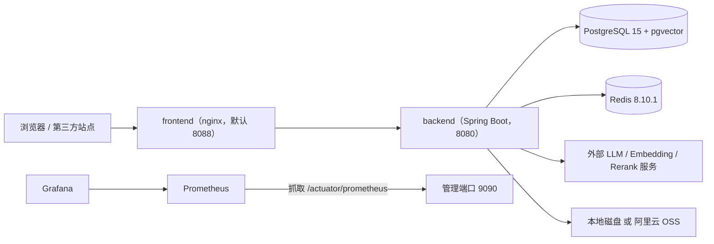
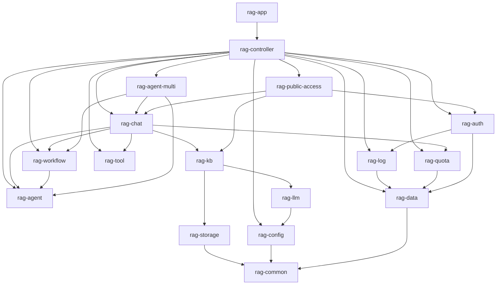
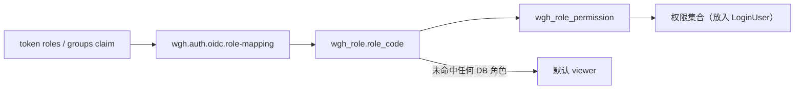
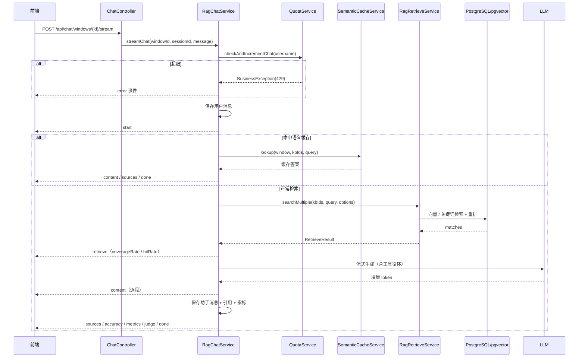
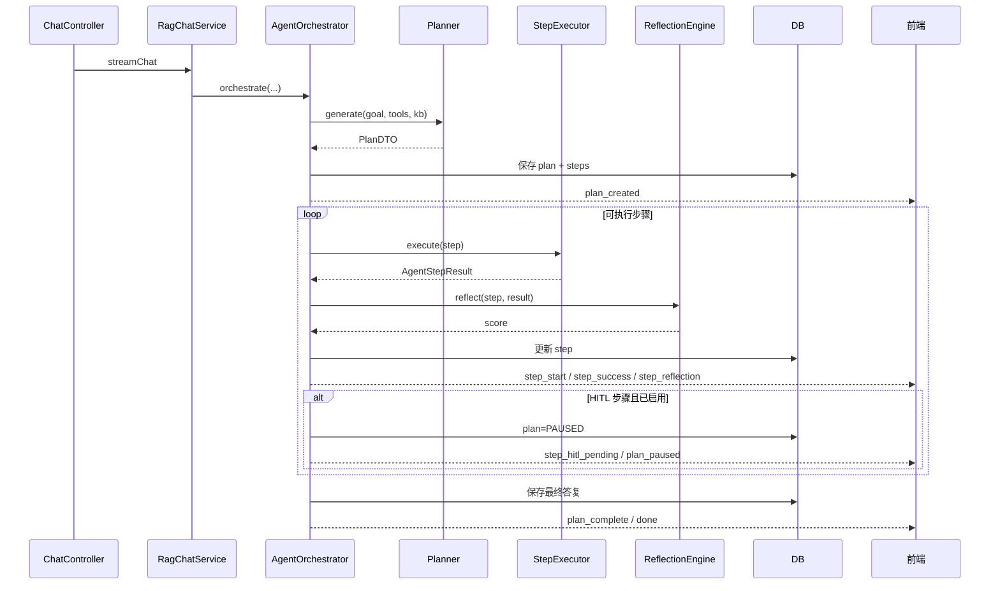
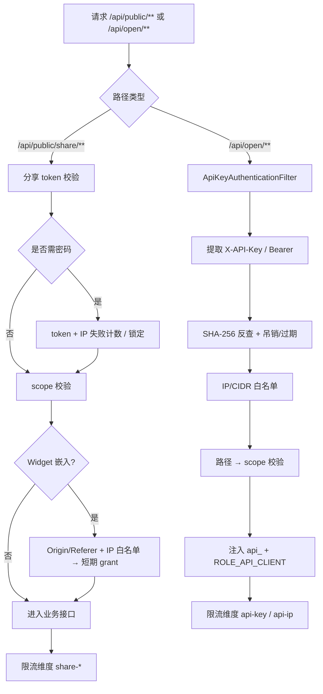

# WGH RAG System — 总体设计文档

| 项目 | 内容 |
| --- | --- |
| 文档版本 | v2.0 |
| 更新日期 | 2026-11-03 |
| 代码基线 | `main@212e90c` + 工作区当前代码（本次仅只读核对） |
| 文档定位 | 系统级总体设计，面向架构评审、需求评审与新成员入门 |
| 配套文档 | 详细设计见 [design-detailed.md](design-detailed.md)；接口清单见 [api.md](../api/api.md) |

> 本文按代码实际状态重写，不描述未实现能力。文中“已实现”均可在对应模块源码中定位；专项能力（Agent、工作流、公开访问、存储、可观测性）的深挖文档见 §1.3。

---

## 1. 文档概述

### 1.1 文档目的

本文回答四个问题：

1. 系统由哪些后端模块组成，模块之间允许怎样的依赖方向；
2. 认证、对话、Agent、工作流、公开访问、配额、存储、可观测性等核心能力如何协同；
3. 数据、部署与运行环境的关键约束是什么；
4. 当前实现有哪些明确边界与已知限制。

### 1.2 系统定位

WGH RAG System 是一套面向企业知识库的 RAG 应用平台，核心能力包括：

- 知识库、文件、切分、检索与向量化；
- 基于知识库的流式问答（含混合检索、重排、查询变换、语义缓存、多模态）；
- 单 Agent 自动规划（Planner / Executor / Reflection / HITL）；
- 可视化工作流编排（DAG、版本、触发器、运行记录、模板市场）；
- 多 Agent 协作（角色分层 Crew / 状态图 Graph / 对话式 GroupChat）；
- 工具调用（HTTP / MCP / Function Calling / Skill）；
- 用户、角色、权限、配额、审计与账号安全；
- 免登录分享、Widget 嵌入、开放 API；
- Prometheus / Grafana 可观测性与统一请求关联。

### 1.3 文档体系

| 文档 | 内容 | 与本文关系 |
| --- | --- | --- |
| [design-detailed.md](design-detailed.md) | 模块、关键类、认证、配额、公开访问、存储、数据、SSE 等详细设计 | 本文的展开 |
| [api.md](../api/api.md) | 对外接口清单与示例 | 接口视图 |
| [design-public-access.md](design-public-access.md) | 分享 / Widget / 开放 API | 专项设计 |
| [quota-design.md](quota-design.md) | 配额模块 | 专项设计 |
| [design-file-storage.md](../design-file-storage.md) | 本地 / 阿里云 OSS 存储抽象 | 专项设计 |
| [design-observability.md](design-observability.md) | 指标、日志、告警 | 专项设计 |
| [design-document-formats.md](design-document-formats.md) | 文档解析格式 | 专项设计 |
| [agent-design.md](../agent-design.md) | 单 Agent | 专项设计 |
| [workflow-design.md](../workflow-design.md) | 工作流 | 专项设计 |
| [multi-agent-overall-design.md](../multi-agent-overall-design.md) / [multi-agent-detail-design.md](../multi-agent-detail-design.md) | 多 Agent | 专项设计 |
| [design-rag-retrieval-enhancement.md](../design-rag-retrieval-enhancement.md) | 混合检索、重排、查询变换、语义缓存 | 专项设计 |
| [design-phase5-platform-features.md](design-phase5-platform-features.md) | 平台化特性阶段记录 | 历史阶段 |
| [design-pattern-refactoring.md](../design-pattern-refactoring.md) | 重构记录 | 历史阶段 |

### 1.4 版本记录

| 版本 | 日期 | 变更 |
| --- | --- | --- |
| v1.0 | 2026-10-28 | 首版反向工程文档（15 张表、仅外部 OIDC、无配额/公开访问/存储/可观测性章节） |
| v2.0 | 2026-11-03 | 按当前代码重写：17 模块依赖、双认证、RBAC、密码体系、配额、公开访问、存储抽象、可观测性、37 张表、Docker Compose、已知限制 |

---

## 2. 技术栈与运行形态

### 2.1 技术栈

| 层次 | 选型 | 版本 / 说明 |
| --- | --- | --- |
| 语言与构建 | Java + Maven | JDK 21（`maven.compiler.release=21`，Enforcer 固定 `[21,22)`） |
| 应用框架 | Spring Boot | 3.4.5 |
| LLM 编排 | LangChain4j | 1.19.0（community/starter 1.19.0-beta29） |
| 持久层 | MyBatis-Plus | 3.5.7，PostgreSQL 方言分页 |
| 数据库 | PostgreSQL + pgvector | `pgvector/pgvector:pg15`，结构要求 PostgreSQL 15+ |
| 缓存 / 限流 | Redis | `redis:8.10.1-alpine`，Lua 滑动窗口 |
| 鉴权 | OIDC 资源服务器 + 本地内部 JWT | jjwt 0.12.6 |
| 向量存储 | pgvector（复用 HikariCP） | `EmbeddingStore<TextSegment>` 抽象 |
| 接口文档 | Knife4j / springdoc | Knife4j 4.5.0，springdoc 2.8.6 |
| 指标 | Micrometer + Prometheus | 业务埋点 `RagMetrics` |
| 前端 | Vue 3 / Vite 5 / Element Plus | 3.5.12 / 5.4.10 / 2.8.8 |
| 部署 | Docker Compose | postgres、redis、backend、frontend、prometheus、grafana |

### 2.2 运行拓扑

业务端口（默认 `8080`）只承载业务接口；健康检查、指标与 Prometheus 抓取走独立管理端口（默认 `9090`），二者可通过网络策略隔离。

---

## 3. 模块化架构

### 3.1 模块清单（17 个）

| # | 模块 | 职责 | 关键类 / 能力 | 显式依赖 |
| --- | --- | --- | --- | --- |
| 1 | `rag-common` | 纯契约与通用基础设施：统一响应、异常、错误码、`LoginUser`、MDC、指标入口、模板、Web 配置 | `ApiResponse`、`ResultCode`、`BusinessException`、`LoginUser`、`MdcContext`、`RagMetrics` | 无业务模块依赖；**零 MyBatis/ORM 依赖** |
| 2 | `rag-data` | 持久层公共基座 | `BaseEntity`、`MetaObjectHandlerImpl`、`MybatisPlusConfig`、`BooleanToSmallintTypeHandler` | `rag-common` |
| 3 | `rag-log` | 审计日志 | `@Audit`、`AuditAspect`、`AuditLogService`（异步写入） | `rag-common`、`rag-data` |
| 4 | `rag-auth` | 认证、RBAC、密码体系 | `OidcTokenVerifier`、`JwksProvider`、`LocalTokenService`、`LocalLoginService`、`PermissionAspect`、`SecurityConfig` | `rag-common`、`rag-data`、`rag-log` |
| 5 | `rag-quota` | 用户配额 | `QuotaService`、`EffectiveQuota`、`QuotaAdminGuard` | `rag-common`、`rag-data` |
| 6 | `rag-config` | 全局配置 | `RagProperties`（检索 / 分割 / 上下文 / 缓存）、`PgVectorConfig`、Redis 端口抽象 | `rag-common` |
| 7 | `rag-storage` | 文件存储抽象 | `FileStorageService`、`StoredObject`、`StorageKeys`、`LocalFileStorageService`、`AliyunOssFileStorageService` | `rag-common` |
| 8 | `rag-llm` | 模型接入与路由 | `ChatModelFactoryRegistry`、`ModelCacheManager`、`ModelRouter`、`ModelPriceService`、`TokenEstimator` | `rag-data`、`rag-config` |
| 9 | `rag-kb` | 知识库域 | `KnowledgeBaseService`、`KnowledgeFileService`、`RagRetrieveService`、切分策略、`SemanticCacheService`、`RerankService`、`QueryTransformService` | `rag-data`、`rag-storage`、`rag-llm` |
| 10 | `rag-chat` | 对话编排 | `RagChatService`、`ContextCompressionService`、`PromptTemplateService`、`ChatWorkflowService`、评估（`EvaluationScheme` / `LlmJudgeService`）、`SkillLlmClientImpl` | `rag-data`、`rag-kb`、`rag-tool`、`rag-agent`、`rag-workflow`、`rag-quota` |
| 11 | `rag-tool` | 工具定义与执行 | `ToolExecutionEngine`、`HttpToolExecutor`、`McpToolExecutor`、`FunctionCallingToolExecutor`、`SkillToolExecutor`、`SkillLlmClient` | `rag-data`、`rag-config` |
| 12 | `rag-agent` | 单 Agent | `AgentOrchestrator`、`Planner`、`StepExecutor`、`ReflectionEngine` | `rag-config`、`rag-common`、`rag-llm`、`rag-kb`、`rag-tool` |
| 13 | `rag-workflow` | 工作流引擎 | `WorkflowEngine`、`GraphValidator`、节点执行器、版本 / 触发器 / 运行记录 | `rag-config`、`rag-common`、`rag-data`、`rag-llm`、`rag-kb`、`rag-tool`、`rag-agent` |
| 14 | `rag-agent-multi` | 多 Agent | `MultiAgentRun`、`CrewCoordinator`、`GraphCoordinator`、`GroupChatCoordinator` | `rag-agent`、`rag-workflow`、`rag-tool`、`rag-kb`、`rag-llm`、`rag-chat`、`rag-config`、`rag-common` |
| 15 | `rag-public-access` | 免登录分享 / Widget / 开放 API | `ShareLinkService`、`ApiKeyService`、`EmbedAccessService`、`DefaultPublicAccessStore`、`ApiKeyAuthenticationFilter` | `rag-common`、`rag-data`、`rag-auth`、`rag-config`、`rag-chat`、`rag-kb` |
| 16 | `rag-controller` | 统一 Controller 层（唯一组合根） | 21 个 Controller、SSE 适配、统一异常处理 | `rag-data`、`rag-config`、`rag-auth`、`rag-log`、`rag-public-access`、`rag-chat`、`rag-agent`、`rag-tool`、`rag-workflow`、`rag-agent-multi`、`rag-quota` |
| 17 | `rag-app` | 启动与装配 | `RagApplication`、`application*.yml`、Docker 入口 | `rag-data`、`rag-auth`、`rag-log`、`rag-controller` |

### 3.2 依赖方向

要点：

- `rag-chat → rag-kb → rag-llm` 是核心 RAG 依赖链；`rag-kb → rag-storage` 承担文件读取。
- `rag-tool` **不依赖** `rag-llm`；Skill 需要调用大模型时通过 SPI 反转：`rag-tool` 定义 `SkillLlmClient` 接口，`rag-chat` 提供 `SkillLlmClientImpl`。
- `rag-public-access` 只被 `rag-controller` 直接依赖；其自身只依赖 `rag-chat`、`rag-kb` 等业务能力。
- `rag-app` 不直接依赖业务模块，只装配 `rag-controller` 与数据/认证/日志。

### 3.3 架构约束

| 约束 | 落地方式 | 说明 |
| --- | --- | --- |
| 禁止反向依赖 | Maven Enforcer | 根 POM 执行 `enforce-public-access-not-consumed`：除 `rag-controller` 外任何模块声明 `rag-public-access` 即构建失败；`rag-controller` 显式 `skip` 该执行（JDK 校验仍保留） |
| 公开访问单向依赖 | `rag-public-access` 自身 Enforcer + 根 POM | `rag-public-access` 内禁止依赖 `rag-controller`；`searchTransitive=false` 避免误伤 `rag-app → rag-controller → rag-public-access` 的传递依赖 |
| JDK 统一 | Maven Enforcer `requireJavaVersion [21,22)` | CI 与本地构建固定 JDK 21，避免 Mockito/ByteBuddy 因 JDK 差异失败 |
| `rag-common` 纯契约 | POM 约束 + 代码评审 | 不引入 `mybatis-plus`；仅保留 `spring-tx` 用于映射 `DuplicateKeyException`，不含任何 ORM 实现 |
| 唯一组合根 | 目录与依赖 | 只有 `rag-controller` 同时依赖全部业务模块；业务模块不得依赖 `rag-controller` / `rag-app` |
| 无循环依赖 | POM 依赖图 | 依赖方向自上而下：controller → 编排 → 领域 → 基础；不存在反向边 |

### 3.4 分层边界

| 层 | 模块 | 允许做的事 | 禁止做的事 |
| --- | --- | --- | --- |
| 启动层 | `rag-app` | 配置装配、启动类、Docker 入口 | 写业务逻辑 |
| 接入层 | `rag-controller` | 参数校验、SSE 适配、调用业务服务、组装响应 | 直接访问 Mapper / 直接写 SQL |
| 编排层 | `rag-chat`、`rag-agent`、`rag-workflow`、`rag-agent-multi`、`rag-public-access` | 用例编排、跨域组合 | 反向依赖 Controller |
| 领域层 | `rag-kb`、`rag-llm`、`rag-tool`、`rag-quota`、`rag-auth`、`rag-log` | 领域规则、持久化、外部调用 | 依赖编排层 |
| 基础层 | `rag-common`、`rag-data`、`rag-config`、`rag-storage` | 契约、基类、配置、存储抽象 | 依赖任何业务模块 |

---

## 4. 核心能力设计

### 4.1 认证与授权

系统同时支持两种凭证，按 JWT header 的 `alg` 分流（`OidcAuthenticationFilter`）：

| 凭证 | 签发方 | 算法 | 验签方式 | 适用账号 |
| --- | --- | --- | --- | --- |
| 外部 OIDC token | 上游 IdP | RS / PS / ES（非对称） | JWKS 公钥验签 | 外部 OIDC 用户 |
| 本地内部 token | 本系统 | HS256（对称） | 本地密钥验签 + 本地 issuer/audience + `tokenType=local` | `source=local` 的 admin / 体验账号 |

**OIDC 资源服务器形态（只验签，不签发）**：

- 解析 header 得到 `alg`、`kid`，先做算法白名单：允许 `RS256/384/512`、`PS256/384/512`、`ES256/384/512`，拒绝 `HS*` 与 `none`；
- 按 `kid` 从 JWKS 取公钥；未知 `kid` 触发一次限频刷新；
- 校验签名、`iss`、`aud`、`exp` / `nbf`（默认 30s 时钟偏差）；
- `issuer` 或 `audience` 未配置时 **fail-closed**，直接拒绝；
- JWKS 缓存 TTL 默认 300s；刷新最小间隔默认 30s（未知 `kid` 最多每 30s 触发一次刷新）；启动阶段不拉取，IdP 不可达不阻断启动，网络失败沿用旧缓存。

**本地登录**：

- 仅 `wgh_user.source = local` 且为 admin 角色或 `trial=1` 的体验账号可登录；
- 口令以 BCrypt 存储；登录成功签发 HS256 内部 token，claim 含 `userId`、`roles`、`pv`（口令版本）、`tokenType=local`；
- 过滤器对本地 token 实时查库校验：用户存在、`status=1`、未过期、`pv` 与 `password_version` 一致，角色/权限实时从 DB 解析；
- 首登强制改密：`password_must_change=1` 时，除 `GET/HEAD/OPTIONS`、`/api/auth/password`、`/api/auth/logout` 外的请求返回 HTTP 403 + 业务码 `1006`。

**角色 → 权限链路**：

- 外部 token：claim 值先经 `role-mapping` 映射，再匹配 `wgh_role.role_code`；全部未命中时使用默认角色 `viewer`。
- 本地 token：直接按 `user_id` 实时查 `wgh_user_role → wgh_role`，为空时默认 `viewer`。
- 权限始终来自 `wgh_role_permission`，不信任 token 内的权限声明。
- 权限校验由 `@RequiresPermission` + `PermissionAspect` 完成；未加注解的接口只要求“已登录”。

**密码体系**：

- `wgh_user.password_version` 单调递增；改密、管理员重置、禁用等操作递增后，旧本地 token 立即失效；
- 修改本人密码：校验旧密码、强度策略（默认 8–128 位、至少含字母与数字）、禁止与当前密码相同，成功后 `password_must_change=0` 并递增 `pv`；
- 管理员只能重置 `trial=1` 的本地体验账号口令，重置后强制下次登录改密；
- 初始 admin 由启动参数 `WGH_INIT_ADMIN_PASSWORD` 创建（仅当库中不存在 `admin` 时），同样 `password_must_change=1`；
- 账号审计由 `AccountAuditService` 显式构造内容，只记录目标账号、操作者、结果与原因，不记录口令明文。

### 4.2 RAG 对话

`RagChatService` 是对话总编排，按窗口配置进入不同分支：

1. **工作流分支**：`chat_window.workflow_id` 非空时，每条用户消息触发一次完整工作流运行；
2. **语义缓存**：窗口开启且无图片时，按窗口 + 知识库 + 问题向量查找缓存，命中则直接返回缓存答案，跳过检索与 LLM；
3. **知识库检索**：多知识库联合检索，支持窗口级混合检索（向量 + 关键词 RRF）、重排、查询变换（NONE / REWRITE / MULTI_QUERY / HYDE）；
4. **Agent 分支**：窗口开启 `agent_enabled` 时进入 Planner → Executor → Reflection → HITL；
5. **工具分支**：按窗口 `tool_ids` 注册工具，最多 5 轮工具调用，工具结果超 4000 字符截断；
6. **普通 RAG**：无检索结果且无工具/图片时返回兜底话术；否则组装 RAG Prompt 调用 LLM；
7. **评估**：窗口级 `evaluation_scheme` 支持 `NONE / METRICS / LLM_JUDGE / BOTH`，生成侧 judge 异步执行，不阻塞 SSE；
8. **配额**：发送前校验并累加对话条数，完成后累加 token 用量；
9. **上下文压缩**：历史消息超过 20 条触发分层压缩（近期原文、中期摘要、远期事实），失败降级为简单截断；
10. **多模态**：窗口模型 `supportsVision=true` 时支持图片 data URL / 公网 URL，图片不参与语义缓存。

SSE 事件：`start`、`retrieve`、`content`、`sources`、`accuracy`、`metrics`、`model_switch`、`tool_call_start`、`tool_call_result`、`judge`、`done`、`error`。`content` 使用 JSON 包装文本，避免换行丢失。

在线检索指标：下发 `coverageRate`（返回条数 / topK）与 `hitRate`（高分条数 / 返回条数），不把 `coverageRate` 当作 Recall；真实 `Recall@K` 依赖标注集，仅在离线/评测接口计算。

### 4.3 单 Agent

- **Planner**：按目标与可用工具/知识库生成结构化计划（步骤、依赖、工具、HITL 标记）；
- **Executor**：逐步执行，内部最多 5 轮 ReAct 工具调用；
- **Reflection**：Critic 打分，低于阈值按窗口配置重试；
- **HITL**：窗口级 `agent_hitl_enabled=1` 时，Planner 标记 `hitl=true` 的步骤暂停，等待人工确认后续跑；
- **状态机**：`RUNNING / PAUSED / COMPLETED / FAILED / CANCELLED`；前端刷新后可通过 `GET /api/agent/plans/{id}/state` 恢复；
- **结果持久化**：先落库再尽力发送 SSE，避免客户端断开丢结果；SSE 发送失败仅告警，不触发“降级普通 RAG”。

### 4.4 工作流

- 可视化 DAG，节点类型 11 种：`START / END / LLM / RETRIEVAL / TOOL / CONDITION / LOOP / HITL / VARIABLE / WORKFLOW / AGENT`；
- 保存时生成版本快照，支持回滚（回滚也生成新版本）；
- 触发器支持 CRON 定时与 WEBHOOK；Webhook 入口凭路径 token 鉴权，免登录；
- 运行实例与节点级执行记录分别落 `wgh_workflow_run` / `wgh_workflow_node_run`；
- HITL 节点暂停/恢复；并行调度基于入边计数与回边白名单；
- 模板市场内置模板一键实例化，自动填充第一个启用的 LLM 模型占位 `modelId`；
- 聊天窗口可绑定工作流（阶段 A）；分享态运行强制 `safeMode=true`（HTTP 仅 GET/HEAD、禁 MCP）。

### 4.5 工具

| 类型 | 执行器 | 说明 |
| --- | --- | --- |
| HTTP | `HttpToolExecutor` | 按配置发起 HTTP 请求，超时与错误结构化返回 |
| MCP | `McpToolExecutor` + `McpClientManager` | 支持 stdio / SSE transport |
| Function Calling | `FunctionCallingToolExecutor` | 内置函数处理器（如订单查询） |
| Skill | `SkillToolExecutor` | 目录 / 内联两种模式，支持 references；通过 `SkillLlmClient` 回调 rag-chat 调模型 |

- 工具定义以 OpenAI function JSON Schema 存储，兼容 LangChain4j 1.19.0 `ToolSpecification` 构建；
- 工具按聊天窗口 `tool_ids` 隔离，通过 ThreadLocal 注册与快照，避免并发串用；
- 工具调用过程通过 SSE `tool_call_start` / `tool_call_result` 实时通知前端。

### 4.6 配额

- **优先级**：`wgh_user_quota_config`（存在且 `enabled=1`）> 全局默认 `wgh.rag.quota.*`；
- **周期**：`DAY`（`yyyy-MM-dd`）与 `MONTH`（`yyyy-MM`）；全局默认按自然日；
- **维度**：对话条数 `chat_count`、token 用量 `token_used`，`<=0` 视为不限制；
- **超限**：抛 `QUOTA_EXCEEDED(429)`，HTTP 仍为 200（统一响应体），SSE 前端会解析错误体；
- **并发**：`INSERT ... ON CONFLICT (username, date_key) DO UPDATE` 原子累加，计数不丢失；
- **降级**：配额查询/写入异常只记 WARN，不阻断聊天。

### 4.7 公开访问

| 入口 | 鉴权 | 关键能力 |
| --- | --- | --- |
| 免登录分享 `/api/public/share/**` | `shareToken` + 可选访问密码 | 范围 `WINDOW / SESSION / KB`、有效期、最大次数、吊销、密码失败锁定 |
| Widget 嵌入 | `shareToken` + 域名/IP 白名单 + 短期 grant | `/widget.js` 先授权再注入 iframe；grant 默认 30 分钟 |
| 开放 API `/api/open/v1/**` | `X-API-Key` / Bearer Key | scope、IP/CIDR 白名单、调用日志、配额与限流 |

- **限流**：Redis Lua 滑动窗口，维度 `share-token / share-ip / share-chat / share-kb / share-embed / api-key / api-ip`，key 由“维度 + 主体 + 接口路径”组成；Redis 不可用时降级为单机内存并输出 WARN；
- **分享密码**：按 `token + 客户端 IP` 计失败次数，默认 5 次失败锁定 15 分钟，成功可重置；
- **API Key**：仅存 SHA-256 哈希，明文创建时返回一次；校验顺序为 提取 → 哈希反查 → 吊销/过期 → IP 白名单 → scope；
- **来源 IP**：仅在 `wgh.public-access.trusted-proxies` 命中可信反向代理 CIDR 时才采信 `X-Forwarded-For` / `X-Real-IP`。

### 4.8 文件存储抽象

- 统一契约 `FileStorageService`：`store / openStream / delete / resolveUrl / exists`；`StoredObject` 为逻辑 key + 大小 + 内容类型；
- key 规则：`kb/{kbId}/{fileUuid}/{sanitize(fileName)}`，每次上传独立 UUID，同名不覆盖，过滤路径穿越字符；
- 通过 `wgh.rag.storage.type=local|oss` 切换实现，业务代码不变；
- 历史兼容：`wgh_knowledge_file.file_path` 不新增列；新数据存逻辑 key，历史 `./uploads/...` 路径由本地实现识别并做根目录校验后读取；
- 本地写入使用临时文件 + 原子移动；OSS 写入先落临时文件再流式 `putObject`，失败按 `max-retries` 重试并清理残留对象；
- 删除失败只记 WARN，数据库仍逻辑删除（可能留孤儿对象）。

### 4.9 可观测性

- **指标**：Micrometer + Prometheus registry，`RagMetrics` 统一埋点，指标前缀 `wgh.`（Prometheus 侧为 `wgh_`）；标签只取有限枚举（route / stage / provider / dimension / status / nodeType），禁止 userId / windowId / sessionId 等高基数标签；
- **业务指标**：代码当前定义 15 个指标名，分 6 类：
  - 对话 4：`wgh.chat.requests`、`wgh.chat.duration`、`wgh.chat.first.token`、`wgh.chat.errors`；
  - 检索 3：`wgh.retrieval.duration`、`wgh.retrieval.hits`、`wgh.retrieval.errors`；
  - LLM 3：`wgh.llm.calls`、`wgh.llm.tokens`、`wgh.llm.cost`；
  - 配额 1：`wgh.quota.exceeded`；
  - 公开访问 2：`wgh.public.access.requests`、`wgh.rate.limit.rejected`；
  - 工作流 2：`wgh.workflow.runs`、`wgh.workflow.node.failures`；
  另有 JVM、HikariCP、HTTP 等 Micrometer 自动指标；
- **请求关联**：`X-Request-Id` → `RequestIdFilter` → MDC → 日志 `[rid=...]`；异步线程通过 `MdcContext.wrap` / `TaskDecorator` 继承；
- **端口隔离**：`management.server.port=9090`，业务端口不暴露 `/actuator`；
- **可视化**：`deploy/prometheus` + `deploy/grafana/dashboards/wgh-rag-overview.json`。

### 4.10 数据层

- **37 张业务表**，按域分组见 §6.1；另有 pgvector 动态表 `rag_vector_store` 与 `wgh_semantic_cache_vec`；
- **公共基类** `BaseEntity`：`id`、`create_time`、`update_time`、`create_by`、`update_by`、`deleted`；
- **逻辑删除**：MyBatis-Plus 全局 `deleted`（0/1），删除操作默认逻辑删除；
- **布尔约定**：PostgreSQL 列使用 `SMALLINT`，实体 `Boolean` 字段配 `@TableField(typeHandler = BooleanToSmallintTypeHandler.class)`；`LambdaQueryWrapper` 比较使用字面量 `1/0`；
- **向量**：`EmbeddingStore<TextSegment>` 抽象，默认 pgvector 表 `rag_vector_store`；按 embedding 模型 ID 分组，避免不同维度向量混用；重切/删除文件时同步清理旧向量；
- **SQL 组织**：`schema/01-schema.sql`（DDL + 索引 + COMMENT，结构幂等）与 `seed/02-data.sql`（种子 + 兼容修复；含示例数据，不建议对存量库重跑），按顺序执行。

---

## 5. 关键流程

### 5.1 普通 RAG 对话（SSE）

### 5.2 Agent 自动规划

### 5.3 工作流执行

```mermaid
sequenceDiagram
    participant FE as 前端/触发器
    participant W as WorkflowEngine
    participant N as NodeExecutor
    participant DB as DB
    participant L as LLM/KB/Tool

    FE->>W: 运行工作流
    W->>DB: 创建 run
    W-->>FE: workflow_start
    loop DAG 节点
        W->>N: 执行节点
        N->>L: LLM / 检索 / 工具
        L-->>N: 结果
        N-->>W: 节点输出
        W->>DB: node_run 落库
        W-->>FE: node_start / node_output
        alt HITL 节点
            W->>DB: run=PAUSED
            W-->>FE: node_hitl_pending
        end
    end
    W->>DB: run=COMPLETED
    W-->>FE: workflow_complete
```

### 5.4 公开访问鉴权

---

## 6. 数据与部署

### 6.1 数据表分组（37 张）

| 域 | 表 | 数量 |
| --- | --- | --- |
| 模型与价格 | `wgh_llm_model`、`wgh_embedding_model`、`wgh_model_price` | 3 |
| 知识库 | `wgh_knowledge_base`、`wgh_knowledge_file`、`wgh_knowledge_file_version`、`wgh_kb_ground_truth`、`wgh_semantic_cache` | 5 |
| 标签 | `wgh_tag`、`wgh_kb_tag_rel`、`wgh_file_tag_rel` | 3 |
| 聊天 | `wgh_chat_window`、`wgh_chat_session`、`wgh_chat_message` | 3 |
| 工具与提示词 | `wgh_tool`、`wgh_prompt_template` | 2 |
| 单 Agent | `wgh_agent_plan`、`wgh_agent_step` | 2 |
| 工作流 | `wgh_workflow`、`wgh_workflow_version`、`wgh_workflow_trigger`、`wgh_workflow_run`、`wgh_workflow_node_run` | 5 |
| 多 Agent | `wgh_m_agent_run`、`wgh_m_agent_step`、`wgh_m_agent_crew` | 3 |
| 账号与 RBAC | `wgh_user`、`wgh_role`、`wgh_permission`、`wgh_user_role`、`wgh_role_permission` | 5 |
| 审计 | `wgh_audit_log` | 1 |
| 配额 | `wgh_quota_usage`、`wgh_user_quota_config` | 2 |
| 公开访问 | `wgh_share_link`、`wgh_api_key`、`wgh_api_call_log` | 3 |
| **合计** |  | **37** |

说明：`rag_vector_store` 与 `wgh_semantic_cache_vec` 由 pgvector/LangChain4j 运行时建表，不计入 37 张业务表。

### 6.2 部署单元（Docker Compose）

| 服务 | 镜像 | 端口 | 说明 |
| --- | --- | --- | --- |
| `postgres` | `pgvector/pgvector:pg15` | 容器内 5432 | 首次启动执行挂载的 `schema/01-schema.sql` / `seed/02-data.sql`；默认不映射宿主端口 |
| `redis` | `redis:8.10.1-alpine` | 6379:6379 | 限流、密码锁定、Widget grant；AOF 持久化 |
| `backend` | 本地构建 `eclipse-temurin:21-jre-alpine` | 8080（管理 9090 仅容器网络） | Spring Boot 单实例 |
| `frontend` | 本地构建 `nginx:1.27-alpine` | 8088 → 80 | 静态资源 + API 代理 |
| `prometheus` | `prom/prometheus:v2.55.1` | 9091 → 9090 | 抓取 backend 管理端口 |
| `grafana` | `grafana/grafana:11.3.0` | 3000 | 预置仪表盘 |

- 后端构建与运行镜像统一 JDK 21（`maven:3.9-eclipse-temurin-21` / `eclipse-temurin:21-jre-alpine`）；
- 前端构建 Node 20 alpine。

### 6.3 环境与配置

| Profile | 用途 | 数据源 | 敏感配置 |
| --- | --- | --- | --- |
| `dev` | 本地开发 | 本地 PostgreSQL | 允许缺省，本地 token 可用随机密钥（重启失效） |
| `test` | 测试 | 测试库 | 测试专用配置 |
| `prod` | 生产 | 环境变量 / 外部配置 | 必须注入 `WGH_AUTH_LOCAL_JWT_SECRET`、`WGH_INIT_ADMIN_PASSWORD`、数据库口令等 |

生产必须注入的密钥：

| 变量 | 用途 |
| --- | --- |
| `WGH_AUTH_LOCAL_JWT_SECRET` | 本地内部 token HS256 密钥，至少 32 字节；生产未配置则启动失败 |
| `WGH_INIT_ADMIN_PASSWORD` | 首次创建 admin 的口令；库中已存在 admin 时不使用 |
| `POSTGRES_PASSWORD` / `SPRING_DATASOURCE_PASSWORD` | 数据库口令 |
| `WGH_OIDC_ISSUER` / `WGH_OIDC_AUDIENCE` / `WGH_OIDC_JWKS_URI` | 外部 OIDC；不接入可留空，但带外部 token 的请求会被拒绝 |
| `WGH_JWT_SECRET` | 兼容 `prod` profile 历史配置项（`wgh.jwt.secret`），建议与本地密钥同值 |

---

## 7. 非功能设计

### 7.1 安全

- 外部 token 与本地 token 使用不同算法、不同密钥与不同 issuer/audience，互不可冒充；
- 算法白名单拒绝 `HS*` / `none`，防止算法混淆；
- OIDC 配置缺失 fail-closed；JWKS 未知 `kid` 刷新限频，避免伪造 `kid` 打爆 IdP；
- 权限始终查 DB，不信任 token 权限声明；
- 本地口令 BCrypt；`password_version` 使旧凭证立即失效；首登强制改密；
- 审计不记录口令明文；账号事件由 `AccountAuditService` 显式构造；
- 分享密码 BCrypt；API Key 仅存 SHA-256；IP 白名单支持 CIDR；
- 公开访问独立安全过滤链（`@Order(1)`，`securityMatcher=/api/public/**`、`/api/open/**`），不放开既有 JWT 白名单。

### 7.2 可靠性与降级

| 依赖 | 不可用时行为 |
| --- | --- |
| PostgreSQL / pgvector | 启动不阻断（`initialization-fail-timeout=-1`）；向量存储可降级内存（`WGH_PGVECTOR_FALLBACK`），生产默认关闭 |
| Redis | 不阻断启动；限流/密码锁定/Widget grant 降级单机内存并 WARN |
| IdP / JWKS | 启动不拉取；网络失败沿用旧缓存；无缓存时外部 token 按 401 |
| LLM | 普通 RAG 有路由组时按优先级尝试链路；Agent/Workflow 不做跨模型切链 |
| 上下文压缩 LLM | 超时/无模型配置时降级为简单截断，不阻塞主流程 |
| 配额 | DB 异常只记 WARN，不阻断聊天 |
| 文件存储 | 删除失败仅 WARN，业务记录仍逻辑删除 |

### 7.3 性能

- HikariCP 连接池（默认 max 20 / min 5），pgvector 复用同一连接池；
- 知识库文件异步处理使用独立线程池，避免裸线程与外部 API 限流；
- SSE 流式输出，30 分钟超时；异步链路继承 MDC；
- 检索默认 `topK=5`、`minScore=0.3`（生产 0.35）；重排、混合检索、查询变换按窗口开关，默认关闭；
- 语义缓存默认阈值 0.95、每窗口 500 条、TTL 1440 分钟；
- 上下文压缩默认超过 20 条触发，近期 4 轮、中期 6 轮、远期事实 400 token。

### 7.4 可观测性

- 业务指标 15 个（见 §4.9）+ JVM/HikariCP/HTTP 自动指标；
- `X-Request-Id` 贯穿请求线程、异步线程、SSE 日志；
- 管理端口独立，Prometheus 抓取 `/actuator/prometheus`，Grafana 预置总览面板。

---

## 8. 已知限制

| # | 限制 | 影响 | 现状 |
| --- | --- | --- | --- |
| 1 | 大文件分片上传未实现 | OSS 仅单次流式 `putObject`，超大文件/弱网易失败；业务侧默认限制 50MB | 未实现 |
| 2 | `local` ↔ `oss` 不自动迁移 | 切换存储类型后历史对象无法跨后端回读；需手工迁移或重新上传并重建向量 | 设计取舍 |
| 3 | OSS 删除失败留孤儿对象 | 删除只 WARN，数据库逻辑删除成功，对象可能残留 | 需离线清理脚本 |
| 4 | 多实例 JWKS 缓存不共享 | 每个实例独立缓存，轮换后各实例刷新时间不一致；未知 `kid` 限频 30s | 单实例部署假设 |
| 5 | 模型故障转移边界 | 普通 RAG、Agent（Planner / Step / Reflection）与工作流 LLM 节点已统一复用 `failover` 组件，首内容前失败切链并下发 `model_switch`；已产出内容后失败不切链 / 不回滚 / 不重发 | 设计边界（不支持续接或拼接第二个模型输出） |
| 6 | 本地 `resolveUrl` 非可直接下载地址 | 应用未挂载 `base-dir` 静态服务，返回值仅表达逻辑前缀 | 需静态服务配合 |
| 7 | Redis 降级为单机内存 | 多实例下限流/锁定/grant 不一致 | 单实例部署假设 |

---

## 9. 术语

| 术语 | 含义 |
| --- | --- |
| RAG | Retrieval-Augmented Generation，检索增强生成 |
| pgvector | PostgreSQL 向量扩展，本项目向量存储 |
| JWKS | JSON Web Key Set，IdP 公钥集合 |
| `kid` | JWT header 中的密钥 ID |
| `pv` | 本地 token 中的口令版本 claim，与 `wgh_user.password_version` 比对 |
| HITL | Human-in-the-loop，人工确认/介入 |
| SSE | Server-Sent Events，服务端流式推送 |
| RRF | Reciprocal Rank Fusion，混合检索融合算法 |
| MRR / NDCG | 检索排序指标 |
| `safeMode` | 分享态工作流安全模式：HTTP 仅 GET/HEAD、禁用 MCP |
